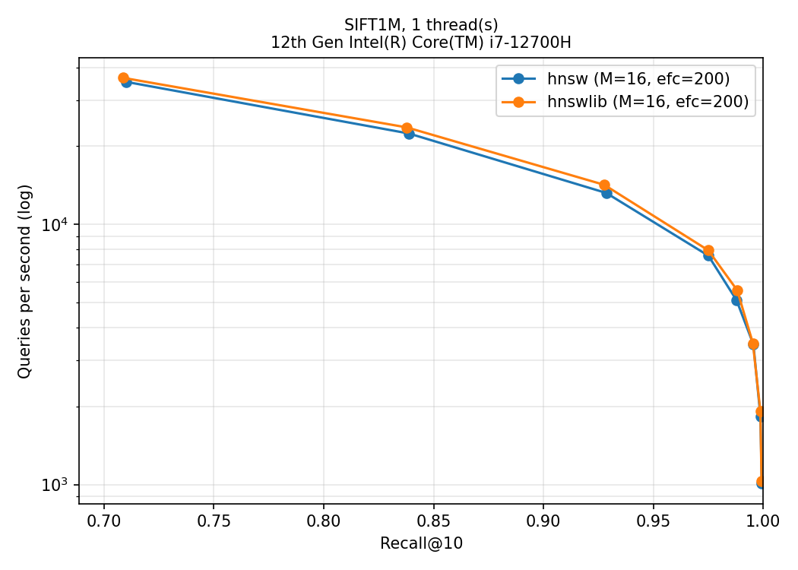

# ann-engine

[](https://github.com/KeepNuo03/ann-engine/actions/workflows/ci.yml)

HNSW approximate nearest neighbor search written from scratch in C++17, with AVX2 distance kernels, a parallel index build, and a reproducible benchmark against [hnswlib](https://github.com/nmslib/hnswlib) on SIFT1M.

On SIFT1M (1M vectors, 128 dimensions), single thread, same graph parameters as hnswlib (M=16, efConstruction=200):

- **recall@10 = 0.975 at 9,288 queries/s** (p99 147 µs), **123%** of hnswlib's throughput at the same recall (7,572 queries/s).
- **recall@10 = 0.9955 at 4,097 queries/s** (p99 335 µs), **116%** of hnswlib (3,522 queries/s).
- Index build: **47 s** on 20 threads (hnswlib: 56 s).



## Results

Machine: Intel Core i7-12700H (6 P-cores + 8 E-cores, 20 threads), 16 GB RAM, Ubuntu 24.04 on WSL2, GCC 13.3, `-O3 -march=native`, AVX2. Single-thread runs are pinned to one P-core with `taskset -c 0`. QPS is the median of 3 to 5 runs after a warmup; latency is measured per query. Raw numbers are in [`results/`](results/).

### Summary

Smallest ef that reaches each recall target, single thread:

| Recall target | Implementation | ef | Recall@10 | QPS | p99 (µs) | Index build (s, 20 threads) |
|---|---|---|---|---|---|---|
| ≥ 0.95 | ours (v3) | 80 | 0.9750 | 9,288 | 147 | 47.1 |
| ≥ 0.95 | hnswlib | 80 | 0.9750 | 7,572 | 249 | 56.0 |
| ≥ 0.99 | ours (v3) | 200 | 0.9955 | 4,097 | 335 | 47.1 |
| ≥ 0.99 | hnswlib | 200 | 0.9953 | 3,522 | 468 | 56.0 |
| exact | brute force, 20 threads | | 0.9994* | 715 | | |

\* Brute force is exact; the missing 0.06% comes from ties in the SIFT ground truth (equal distances ordered differently).

At ef=80 a query computes about 1,500 distances on average, against 1,000,000 for brute force.

### Ablation

The same graph searched with four implementations of the query loop. All four return identical neighbors (checked by a unit test), so recall is the same and only speed changes. Single thread, ef=80 (recall@10 = 0.975):

| Version | Change | QPS | p99 (µs) | vs previous | vs hnswlib |
|---|---|---|---|---|---|
| v0 | visited set is `std::unordered_set` | 4,312 | 358 | | 57% |
| v1 | per-thread `uint16` epoch array for visited | 7,746 | 204 | +79.6% | 102% |
| v2 | + level-0 links and vector interleaved per node, 64-byte aligned | 8,142 | 197 | +5.1% | 108% |
| v3 | + software prefetch of the next neighbor | 9,288 | 147 | +14.1% | 123% |
| hnswlib | reference | 7,572 | 249 | | 100% |

The same pattern holds at ef = 40, 120 and 200 (see [`results/summary.md`](results/summary.md)), with two things worth noting:

- **The visited set matters most.** A hash set costs a hash, a probe and often an allocation per neighbor. The epoch array is one load and one compare, and is cleared by incrementing a counter instead of touching memory.
- **Interleaving alone is not always a win.** At ef=40 v2 is 4.7% slower than v1; at ef=200 it is 10% faster. Packing pads each node to 704 bytes (11 cache lines), and the gain only appears once enough of the search is waiting on memory. Prefetching is what turns the layout into a consistent win: when neighbor j+1's vector sits at a known address next to its links, it can be requested while neighbor j is being scored.

v3 trades memory for speed: the packed level 0 is 704 MB, against 644 MB for links plus vectors stored separately, because of the 64-byte alignment padding.

## How it works

- **Graph layout.** Level 0 is one flat `uint32` array with `1 + M0` slots per node (neighbor count, then ids). Upper levels are only allocated for the ~6% of nodes that reach them. Node levels are drawn as `floor(-ln U / ln M)`, seeded per node id so serial and parallel builds agree.
- **Search.** Greedy descent with ef=1 from the top level to level 1, then a beam search on level 0 with a min-heap of candidates and a max-heap of results capped at ef. Heap storage is reused per thread, so a query does not allocate.
- **Insert.** Search for efConstruction candidates on each level, keep up to M with the paper's neighbor-selection heuristic (Algorithm 4: keep a candidate only if it is closer to the new node than to every neighbor already kept), link both ways, and re-prune any neighbor whose list overflows.
- **Parallel build.** One mutex per node; neighbor lists are copied under the lock before they are traversed; the global lock is held only by an insert that raises the top level.
- **Distance.** Squared L2 with AVX2 + FMA, two independent accumulators (16 floats per iteration), scalar tail; NEON and scalar fallbacks.

### A concurrency bug the tests caught

The first parallel build left 11 to 20 of 10,000 nodes unreachable from the entry point, while hnswlib left none on the same data. A thread inserting node Y could reach node X through an upper level before X had written its own level-0 list, link itself into X's list, and then X's insert overwrote that list with its own selection, dropping Y's only incoming edge. The fix keeps such early edges and re-inserts them through the normal pruning path. The level-0 reachability check in the test suite found it; after the fix five of five parallel builds have zero unreachable nodes on that test. On SIFT1M, 23 of 1,000,000 nodes (0.002%) are unreachable, which comes from heuristic pruning itself and also happens in hnswlib.

## Reproduce

Linux or WSL2, x86-64 with AVX2 (ARM builds use NEON):

```bash
sudo apt install -y build-essential cmake python3-pandas python3-matplotlib
cmake -S . -B build -DCMAKE_BUILD_TYPE=Release && cmake --build build -j
./build/ann_tests                 # unit tests
./scripts/download_sift.sh        # SIFT1M, ~500 MB, into data/sift/
./scripts/run_baselines.sh        # brute force + hnswlib sweep
./scripts/run_hnsw.sh             # our HNSW sweep and the recall/QPS plots
./scripts/run_ablation.sh         # v0..v3 + hnswlib -> results/ablation.csv, results/summary.md
./scripts/profile.sh              # optional: perf stat / perf record (needs linux-tools)
```

Indexes are built with all cores and cached in `results/*.bin` (git-ignored); single-thread query runs then load the cache under `taskset -c 0`. Run benchmarks plugged in with other heavy programs closed.

Tests: 21 cases covering SIMD vs scalar distances (including dimensions that are not multiples of 8), fvecs/ivecs parsing and error cases, brute-force exactness, HNSW recall on random data (≥ 0.99 at ef=200), graph invariants (degree caps, no self loops or duplicates, valid ids, links only to nodes on that level), level-0 reachability, serial determinism, save/load equality, epoch wraparound, and v0 to v3 equivalence. They also pass under AddressSanitizer and UBSan: `cmake -S . -B build-asan -DCMAKE_BUILD_TYPE=Debug -DANN_SANITIZE=ON`.

## Limitations

- In-memory only, float32 vectors, L2 distance. No deletion, updates or filtered search.
- WSL2 does not expose most hardware performance counters, so cache-miss numbers were not collected; the ablation was measured by throughput.
- One dataset (SIFT1M) and one graph configuration (M=16, efConstruction=200).
- Hybrid CPU: single-thread numbers are for one P-core; multi-thread QPS mixes P- and E-cores.

## Layout

```
include/ann/   dataset.h (fvecs/ivecs, 64-byte aligned), distance.h (scalar/AVX2/NEON L2),
               bruteforce.h, hnsw.h, visited.h (epoch visited list), metrics.h, timer.h
src/           hnsw.cpp, bruteforce.cpp
bench/         benchmark driver: --algo brute|hnswlib|hnsw, --variant v0..v3, CSV output
tests/         doctest unit tests
scripts/       download, run, plot, summarize, profile
results/       CSVs, plots and summary.md from the benchmark machine
third_party/   vendored doctest.h (MIT) and hnswlib v0.8.0 headers (Apache-2.0)
```

## References

- Y. A. Malkov, D. A. Yashunin. *Efficient and robust approximate nearest neighbor search using Hierarchical Navigable Small World graphs.* IEEE TPAMI, 2018.
- SIFT1M from the [TEXMEX corpus](http://corpus-texmex.irisa.fr/).
- [hnswlib](https://github.com/nmslib/hnswlib), used as the reference implementation.

## License

MIT, see [LICENSE](LICENSE). Vendored third-party code keeps its own license: doctest (MIT) and hnswlib (Apache-2.0, `third_party/hnswlib/LICENSE`).
